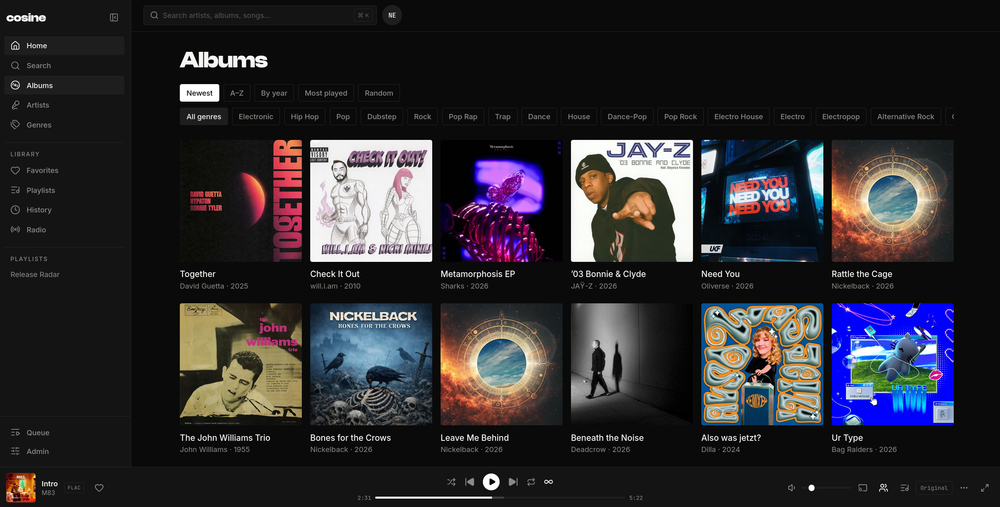
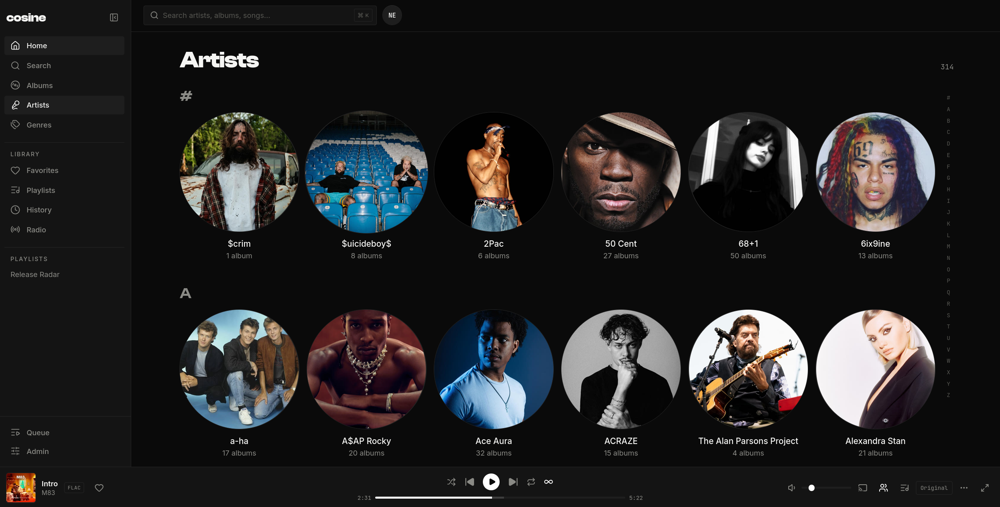
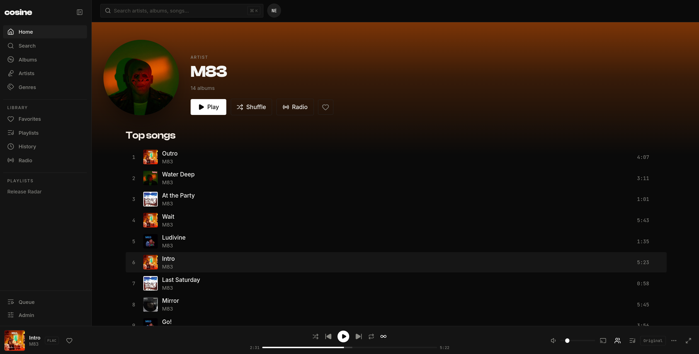
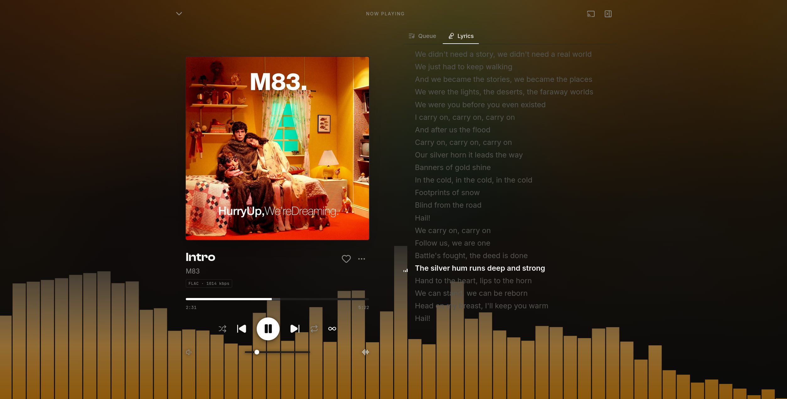
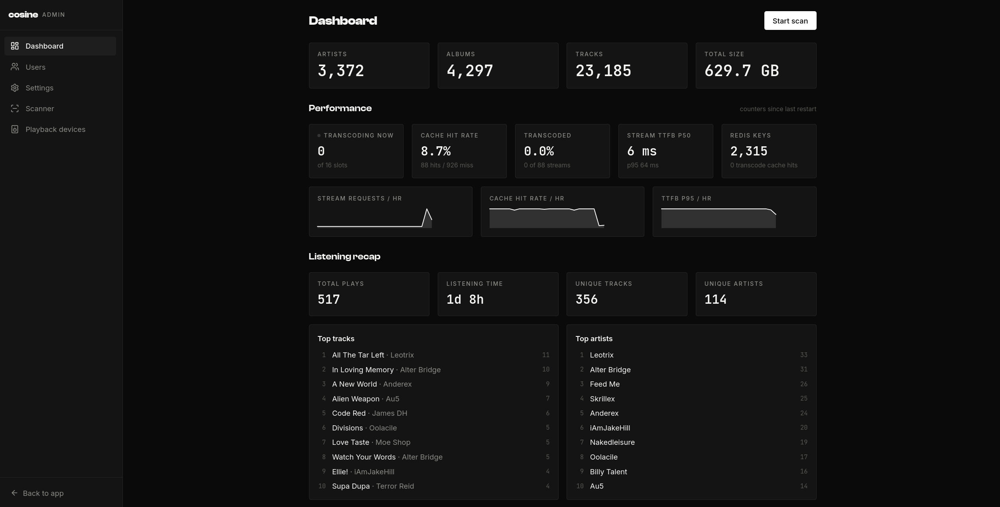

<p align="center">
  
</p>

<h1 align="center">Cosine</h1>

A self-hosted music server with a web player and an OpenSubsonic API.

- Stream your music in the browser or an OpenSubsonic client.
- Manage playlists, favorites, ratings, and listening history.
- Transcode audio with FFmpeg.
- Play to UPnP/DLNA and Sonos devices on your network.

Built with .NET 10, Vue 3, PostgreSQL/pgvector, and Redis.

<a href="assets/screenshots/albums.png"></a>

<details>
<summary>More screenshots</summary>

**Artist library**

<a href="assets/screenshots/artists.png"></a>

**Artist page**

<a href="assets/screenshots/artist-detail.png"></a>

**Now playing**

<a href="assets/screenshots/now-playing.png"></a>

**Admin dashboard**

<a href="assets/screenshots/admin-dashboard.png"></a>

</details>

## Install with Docker Compose

Requires Docker with Compose and OpenSSL. No source checkout or build is needed.

Create a directory and generate the secrets in `.env`:

```bash
mkdir -p cosine-server
cd cosine-server
printf 'JWT_SIGNING_KEY=%s\nPOSTGRES_PASSWORD=%s\nMEDIA_PATH=/srv/music\n' \
  "$(openssl rand -hex 48)" \
  "$(openssl rand -hex 24)" > .env
chmod 600 .env
```

Edit `MEDIA_PATH` in `.env` to point to your existing music directory. Save the
following as `compose.yml` in the same directory:

```yaml
services:
  cosine:
    image: ghcr.io/cosineaudio/cosine:latest
    ports:
      - "8080:8080"
    environment:
      ConnectionStrings__cosine: "Host=postgres;Database=cosine;Username=cosine;Password=${POSTGRES_PASSWORD:?Set POSTGRES_PASSWORD in .env}"
      ConnectionStrings__redis: "redis:6379"
      Jwt__SigningKey: "${JWT_SIGNING_KEY:?Set JWT_SIGNING_KEY in .env}"
      Media__RootPath: /media
      Transcoding__CachePath: /app/transcode-cache
      PUID: "${PUID:-1000}"
      PGID: "${PGID:-1000}"
    volumes:
      - ${MEDIA_PATH:?Set MEDIA_PATH in .env}:/media:ro
      - transcache:/app/transcode-cache
    depends_on:
      postgres:
        condition: service_healthy
      redis:
        condition: service_healthy
    restart: unless-stopped

  postgres:
    image: pgvector/pgvector:pg17
    environment:
      POSTGRES_USER: cosine
      POSTGRES_PASSWORD: "${POSTGRES_PASSWORD:?Set POSTGRES_PASSWORD in .env}"
      POSTGRES_DB: cosine
    volumes:
      - pgdata:/var/lib/postgresql/data
    healthcheck:
      test: ["CMD-SHELL", "pg_isready -U cosine -d cosine"]
      interval: 5s
      timeout: 5s
      retries: 10
    restart: unless-stopped

  redis:
    image: redis:7-alpine
    healthcheck:
      test: ["CMD", "redis-cli", "ping"]
      interval: 5s
      timeout: 5s
      retries: 10
    restart: unless-stopped

volumes:
  pgdata:
  transcache:
```

The app defaults to UID/GID `1000`. If needed, add `PUID` and `PGID` to `.env`
using the values from `id -u` and `id -g` for a user that can read your music.

Start the stack and find the initial admin password:

```bash
docker compose pull
docker compose up -d
docker compose logs cosine
```

Open `http://localhost:8080` (or your server's address). Log in as `admin` with
the password printed on first startup, change it under **Admin → Users**, and
start a library scan under **Admin → Scanner**.

To update, back up your database, then run `docker compose pull` followed by
`docker compose up -d`. `latest` follows the default branch; use a full commit
SHA tag to pin a particular image. Keep `.env` and the database volume between
updates. `docker compose down` stops the stack; adding `--volumes` deletes its
database and transcode cache.

## Build from source

Requires Docker with Compose and OpenSSL for generating a signing key.

```bash
git clone https://github.com/cosineaudio/cosine.git
cd cosine
cp .env.example .env
mkdir -p media
openssl rand -base64 48
```

Copy the generated key into `JWT_SIGNING_KEY` in `.env`. Set `MEDIA_PATH` to your
music directory, or put music in `media/`. Music is mounted read-only.

```bash
docker compose --profile app up --build -d
docker compose logs api
```

Open http://localhost:8080. The first start creates an `admin` account and prints
its generated password to the API log. Log in, change the password under
**Admin → Users**, and start a scan under **Admin → Scanner**.

### Configuration

The Compose settings are in [.env.example](.env.example):

| Variable | Purpose | Default |
| --- | --- | --- |
| `JWT_SIGNING_KEY` | Required signing key; keep it private and stable | Unset |
| `MEDIA_PATH` | Music directory on the host | `./media` |
| `HTTP_PORT` | Web player and API port | `8080` |
| `POSTGRES_PORT` | PostgreSQL port for native development | `55432` |
| `REDIS_PORT` | Redis port for native development | `56379` |
| `PUID`, `PGID` | App container user and group; must be able to read your music | `1000` |

The supplied stack binds ports to localhost. LAN speaker discovery requires
multicast access; use the native API for development with speakers and set
`Playback__AdvertisedBaseUrl` to its reachable LAN URL, such as
`http://192.168.1.10:5222`.

### Stop and remove

```bash
docker compose --profile app down
```

The database and container transcode cache persist in named volumes. Add
`--volumes` to delete them. Back up the database before removing volumes.

### Container images

The [image workflow](.github/workflows/docker.yml) publishes to
`ghcr.io/cosineaudio/cosine`. Branch pushes get a full commit SHA tag and a
sanitized branch-name tag. The default branch also updates `latest`.
Pull requests build without publishing.

## Development

Requires the .NET 10 SDK, Node.js 22.12+ with npm, FFmpeg on `PATH`, and Docker
with Compose. Prepare `.env` and your music directory as described under
[Build from source](#build-from-source).

Start the backing services and install frontend dependencies:

```bash
docker compose up -d --wait
npm --prefix src/Cosine.Web ci
```

Run the API from the repository root:

```bash
export ConnectionStrings__cosine='Host=localhost;Port=55432;Database=cosine;Username=cosine;Password=cosine'
export ConnectionStrings__redis='localhost:56379'
export Jwt__SigningKey="$(openssl rand -base64 48)"
export Media__RootPath="$PWD/media"
export Transcoding__CachePath="$PWD/transcode-cache"
dotnet run --project src/Cosine.Api --launch-profile http
```

The API listens at http://localhost:5222. Adjust the connection strings if you
changed the database or Redis ports. Set `Media__RootPath` to your library if it
is elsewhere. Reuse the signing key between restarts to retain browser sessions.

In another terminal, start the frontend:

```bash
npm --prefix src/Cosine.Web run dev
```

Open the URL Vite prints, normally http://localhost:5173. It proxies requests to
the API. Install frontend dependencies before building the backend; its build
also builds the web player.

### Checks

From the repository root:

```bash
dotnet test Cosine.slnx
npm --prefix src/Cosine.Web test
npm --prefix src/Cosine.Web run build
```

Backend integration tests start their own PostgreSQL/pgvector and Redis
containers through Testcontainers. Docker and FFmpeg must be available.

### Layout

```text
src/              Application code and frontend
tests/            Backend tests, fixtures, and loopback test driver
docker/           Dockerfile and runtime entrypoint
assets/           README screenshots
scripts/          Maintainer scripts
tools/openapi/    OpenSubsonic specification and generation settings
.config/          Local .NET tool manifest
```

Frontend tests live alongside the code they cover. Generated OpenSubsonic types
are checked in. After changing the specification or generator settings, run:

```bash
./scripts/generate-api.sh
```

## Contributing

[Open an issue](https://github.com/cosineaudio/cosine/issues) for bugs or proposed
changes. For bug reports, include reproduction steps, the version or commit,
and relevant logs with credentials removed.

Keep pull requests focused, describe the change, and run the checks above.
Include tests for behavior changes. Discuss larger changes in an issue first.

## License

[GNU Affero General Public License v3.0 only](LICENSE) (`AGPL-3.0-only`).
Third-party components retain their own licenses; see
[THIRD_PARTY_NOTICES.md](THIRD_PARTY_NOTICES.md).
